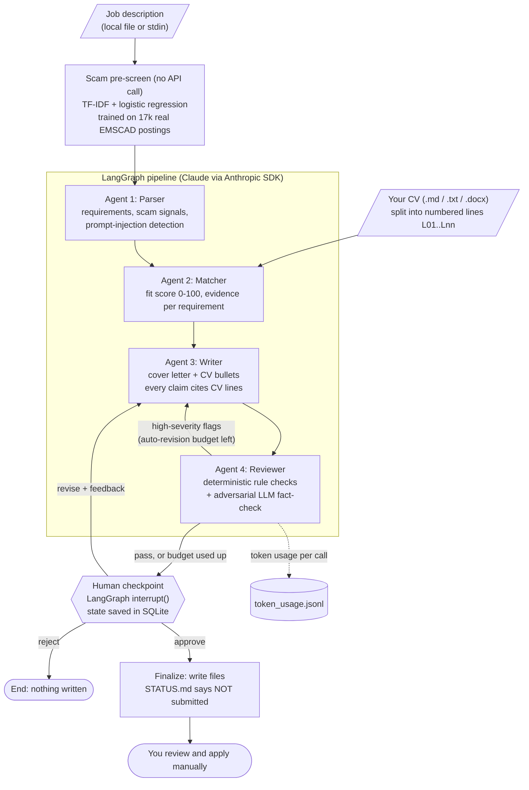

# AutoApplyAgent: a human-in-the-loop job application assistant

> **Tailor every application in minutes, without the tool ever inventing experience or applying on your behalf.**

Writing a tailored cover letter and CV for each role is slow, so many job seekers turn to "AI auto-apply" bots. Those bots tend to do two harmful things: they **fabricate experience** to match keywords, and they **mass-submit** applications. Both hurt the candidate, and the second breaks most job platforms' terms of service.

AutoApplyAgent takes the opposite approach:

| It does | It never does |
|---|---|
| Parses a job description you paste or save to a file | Scrape LinkedIn or job boards, or fetch URLs (URLs are refused) |
| **Screens the posting for job-scam risk** with a classifier trained on 17k real labelled postings, for free, before any API call | Hide uncertainty: the screen shows the terms behind its score |
| Scores your fit against **your CV**, with evidence for each requirement | Submit, send or upload anything |
| Drafts a cover letter and CV bullet suggestions **using only facts in your CV** | Invent employers, titles, dates, tools or metrics |
| Fact-checks the draft (rule checks plus an adversarial reviewer agent) | Finalise output without your explicit approval |
| Pauses for **your approval** and writes files only after you approve | Hide what it changed: every claim cites the CV lines it came from |

Built with **LangGraph** (multi-agent graph, checkpointing, human-in-the-loop `interrupt`), the **Anthropic Python SDK** (structured outputs, prompt caching, token-usage logging) and **scikit-learn** (scam pre-screen trained on real data from Kaggle).

---

## Architecture



### How fabrication is prevented

1. **Citations by construction.** The CV is split into numbered lines (`[L07] Built Power BI dashboards...`). The Writer must return each factual sentence together with the CV line IDs that support it.
2. **Deterministic rule checks** run first. They are cheap and can't be talked out of a verdict. They flag:
   - citations to lines that don't exist, and sentences with no citation at all;
   - numbers (`25%`, `10 years`) that don't appear in the cited lines;
   - job-requirement terms (e.g. "SAP") that appear in the draft but nowhere in the CV;
   - company names that are neither the target employer nor in the CV.
3. **An adversarial LLM Reviewer** treats every claim as unsupported until a cited line proves it. It catches the subtler problems: inflated scope, vague implications, and citations that point to lines saying something else.
4. **Auto-revision loop.** High-severity flags send the draft back to the Writer with the reviewer's feedback, up to `AUTOAPPLY_MAX_AUTO_REVISIONS` times. Any flags left over are shown to you; they are never hidden.
5. **Prompt-injection handling.** Job descriptions are treated as untrusted data. Text aimed at AI screening tools is detected, ignored and shown to you. The bundled sample JD contains one such line on purpose.

## Real data: job-scam pre-screen

Fake job postings are a real risk for job seekers: they harvest personal data or ask for "training fees". So before spending any API tokens, autoapply screens each posting with a classifier trained on real data.

**Dataset:** [Real / Fake Job Posting Prediction](https://www.kaggle.com/datasets/shivamb/real-or-fake-fake-jobposting-prediction) on Kaggle, licensed **CC0 (public domain)**. It is the Employment Scam Aegean Dataset (EMSCAD), from the University of the Aegean (Vidros et al., 2017, *Future Internet* 9(1), 6).
- **Contents:** 17,880 real postings from 2012–2014, with 866 labelled fraudulent.
- **Cleaning:** after removing 395 exact duplicates (which would otherwise leak between train and test), 17,485 postings remain.
- **Not in the repo:** the raw file is git-ignored; download it with the Kaggle CLI (see below).

**Model:** TF-IDF on word unigrams and bigrams, plus class-balanced logistic regression.
- **Input:** posting text only, because that is all a user pastes in.
- **Split:** 60/20/20, stratified. Risk thresholds are chosen on the validation split, and the results below are on the untouched test split.

| Held-out test set (3,497 postings, 4.9% scams) | Precision | Recall |
|---|---:|---:|
| **"High" risk** (p ≥ 0.40) | **0.78** | **0.87** |
| "Medium" or higher (p ≥ 0.14) | 0.41 | 0.94 |
| My hand-written red-flag rules alone | 0.00 | 0.00 |
| PR-AUC 0.914 · ROC-AUC 0.985 | | |

**What the classifier learned:** the terms that most push a posting towards "scam" are *data entry*, *apply using below link*, *receptionist*, *administrative assistant*, *part time* and *earn*. That matches EMSCAD's profile of 2012–14 scams: low-skill, work-from-home, vague-employer roles. Each assessment lists the terms that raised that posting's score, so the risk band is explainable.

**What didn't work, honestly:**
- My regex red flags (fees, bank details, WhatsApp or Telegram contact, free email addresses) produced 307 hits on legitimate postings and only 13 on scams.
- Two reasons: EMSCAD masks emails and phone numbers as `#EMAIL_…#` tokens, and its scams predate today's chat-app scams.
- So the rules **never change the risk band**. They are shown only as an "unvalidated, check yourself" list.

**Two leaks I found and fixed while building this:**
1. *Layout leak:* my own section headings let the model learn "this posting has no company profile" from the bigram "time description". It now trains on the posting's words only (PR-AUC went from 0.909 to 0.914).
2. *Label leak:* exported sample files carry an attribution comment that includes the label. The JD loader now strips HTML comments, so labels can never reach the agents.

```bash
pip install kaggle   # then place your own API token in ~/.kaggle (Kaggle → Settings → API)
```

```bash
kaggle datasets download shivamb/real-or-fake-fake-jobposting-prediction -p data/raw --unzip
```

```bash
autoapply scam train --data data/raw          # ~30 s; prints the metrics above
```

```bash
autoapply scam check --jd data/real_jds/emscad_17618_office-assistant-iii.md
```

```bash
autoapply data sample --data data/raw --keywords "supply chain,logistics,analyst" --n 5
```

`data/real_jds/` contains six real EMSCAD postings (CC0) for trying the pipeline. Four are legitimate supply-chain, operations and analyst roles, and two are labelled scams.

| Posting (real, EMSCAD) | Label | Screen | Terms raising the score |
|---|---|---|---|
| Purchasing / Logistics Lead | legit | low (0.03) | part time, rep, control |
| Business Analyst | legit | low (0.04) | cash, bookkeeping, project |
| Director of Operations, SCM | legit | low (0.08) | efficient, lean, cash |
| BA, Recon / GL | legit | low (0.12) | data, business analyst, program |
| Receptionist / Front Desk | **scam** | **high (0.92)** | receptionist, part time, customer service |
| Office Assistant III | **scam** | **high (0.94)** | data entry, assistant, office assistant |

_These six may be in the training data, so they illustrate the output; the held-out table above is the actual evidence._

## Batch evaluation on real postings

`autoapply eval` runs the four agents on N real postings, scored against your CV, up to the human checkpoint, then **rejects** each run, so nothing is ever finalised. It records:
- fit scores;
- how often drafts pass review, and how often they need an auto-revision;
- rule and LLM fabrication flags;
- whether the Parser spots scam signals in labelled scams;
- tokens per posting.

```bash
autoapply eval --data data/raw --cv data/private/my_cv.docx --keywords "supply chain,logistics,analyst" --n 10 --n-fraud 3
```

Each run writes `results.csv` and `summary.md` to `.autoapply/eval/<id>/`.

## Example run (real data, offline baseline)

autoapply also runs **without an API key**. Set `AUTOAPPLY_MODEL=baseline` and simple, transparent heuristics replace the four agents, while everything else stays real: the scam screen, the grounding checks, the human checkpoint and the outputs.
- **Parser:** splits the posting into sections and bullets.
- **Matcher:** keyword overlap with the numbered CV lines.
- **Writer:** a template letter that quotes CV lines verbatim.
- **Reviewer:** rule checks only.

The baseline is also the yardstick the Claude agents should beat.

Full transcript: **[docs/example_run.md](docs/example_run.md)**. It is a real EMSCAD posting scored against my real CV, followed by a batch of 13 real postings.

| Batch: 10 real analyst / supply-chain postings + 3 labelled scams | Result |
|---|---|
| Scam screen | **3/3 scams rated high risk, 0/10 false alarms** (small sample, may be in-training) |
| Baseline fit scores | Bunched at 50–64; the scams scored "stretch" just like real roles |
| High-severity fabrication flags | 0 (the template only quotes CV lines verbatim) |
| Cost | Free, no API calls |

**Where the baseline fails, and why the LLM agents exist:** for a "Digital Procurement Manager" role it marked *"Fluent in English and Mandarin"* as met, because my CV contains "English" and "fluent". It then scored the role 84/100 "apply", even though the role needs 5+ years of procurement experience and Mandarin. Keyword overlap can't read meaning.

Building the baseline on real postings also exposed bugs in the shared code, all now fixed and tested:
- bullet points glued together when the source HTML was stripped;
- "e.g." splitting one requirement into two;
- the role's own title being flagged as an unsupported claim.

To switch to Claude, set `AUTOAPPLY_MODEL=claude-opus-5-5` and add an API key. No code changes are needed.

## How to run

```bash
git clone https://github.com/3012-pixel/autoapply-agent.git
cd autoapply-agent
python -m venv .venv
.venv\Scripts\activate          # macOS/Linux: source .venv/bin/activate
pip install -r requirements.txt
pip install -e .
cp .env.example .env            # then set ANTHROPIC_API_KEY and AUTOAPPLY_MODEL
```

No API key? Run everything offline with the heuristic baseline:

```bash
autoapply --env-file .env run --jd data/real_jds/emscad_9728_digital-procurement-manager.md --cv data/samples/sample_cv_fictional.md
```

(with `AUTOAPPLY_MODEL=baseline` in `.env`)

Try it on the fictional samples:

```bash
autoapply run --jd data/samples/sample_jd_supply_chain_analyst.md --cv data/samples/sample_cv_fictional.md
```

Use your own CV. Keep it in `data/private/`, which is git-ignored:

```bash
autoapply run --jd my_job.md --cv data/private/my_cv.docx
```

Paste a job description through stdin, and pause at the checkpoint to review later:

```bash
autoapply run --jd - --cv data/private/my_cv.docx --no-interactive
```

Approve, revise or reject a paused run, even from a new terminal session:

```bash
autoapply resume <run_id> --revise "Shorter, and lead with the forecasting work"
```

```bash
autoapply resume <run_id> --approve
```

Check token usage per agent and call:

```bash
autoapply usage --run <run_id>
```

Run the tests (no network or API key needed; they use a scripted fake LLM):

```bash
pytest
```

### Configuration (`.env`)

| Variable | Purpose |
|---|---|
| `AUTOAPPLY_MODEL` | **Required.** The Claude model ID; it is never hardcoded. `.env.example` suggests `claude-opus-5-5`. Use `baseline` for the free offline mode (no API key). |
| `AUTOAPPLY_EFFORT` | `low` / `medium` / `high` / `xhigh` / `max` (default `medium`) |
| `AUTOAPPLY_MAX_AUTO_REVISIONS` | Writer retries after a failed review (default 1) |
| `AUTOAPPLY_REFUSAL_FALLBACK` | Server-side refusal fallback (default `true`). Set `false` for models that don't support it. |
| `AUTOAPPLY_DATA_DIR` | Where checkpoints, token logs and approved outputs go (default `.autoapply/`) |
| `ANTHROPIC_API_KEY` | Read by the Anthropic SDK. autoapply never reads or logs it. |

### Outputs (after approval only)

Approved runs are written to `.autoapply/outputs/<run_id>/`:

| File | Contents |
|---|---|
| `STATUS.md` | Notes that the run was approved but **not submitted** |
| `cover_letter.md` | The approved cover letter |
| `cv_suggestions.md` | CV bullet rewrites, plus the gaps deliberately not claimed |
| `match_report.md` | Fit score with evidence per requirement |
| `review.md` | Every reviewer flag and where it came from |
| `usage.md` | Token usage per agent |

Every model call is also appended to `.autoapply/token_usage.jsonl`, recording the agent, model, input / cache-read / cache-write / output tokens and latency.

## Ethics, terms of service and privacy

- **No scraping, no bots.** Most job boards' terms of service, LinkedIn's included, prohibit scraping and automated activity. This tool works only with text you supply, and refuses URLs.
- **No automated submission.** There is no submit step in the graph and no submit command in the CLI. You stay the author: you read, edit and send every application yourself.
- **Honesty by design.** The tool rephrases; it doesn't embellish. The reviewer exists to stop you sending a claim your CV can't back up. Even so, read the final letter. You are accountable for what you send.
- **Employer AI policies.** Some employers ask candidates to disclose AI assistance or forbid it. Check, and follow their rules.
- **Privacy.** Your CV and the job description are sent to the Anthropic API to generate the draft. Everything else (checkpoints, logs, outputs) stays on your machine under `.autoapply/`, and `data/private/` is git-ignored. Don't commit your CV or `.env`.
- **Untrusted job descriptions.** JD text is handled as data. Embedded instructions to AI systems are ignored and surfaced to you.

## Project structure

```
src/autoapply/
  config.py      settings from env (.env); model ID required, never hardcoded
  documents.py   CV loader (numbered lines) and JD loader (refuses URLs)
  models.py      Pydantic outputs: ParsedJD, MatchReport, Draft, ReviewReport
  prompts.py     system prompts for the four agents
  llm.py         Anthropic client: structured outputs, caching, refusal handling, token logging
  grounding.py   deterministic fabrication checks
  scamcheck.py   scam pre-screen: classifier (trained on EMSCAD) + unvalidated red-flag checklist
  datasets.py    EMSCAD loader (dedupe, text building), sampling, export
  evaluate.py    batch evaluation on real postings (never finalises)
  baseline.py    offline no-LLM baseline for all four agents (AUTOAPPLY_MODEL=baseline)
  graph.py       LangGraph StateGraph, human interrupt, finalize
  usage.py       JSONL token log and summaries
  cli.py         `autoapply run | resume | usage`
tests/           50 tests with a scripted fake LLM, the offline baseline and synthetic EMSCAD-shaped data (no network needed)
data/samples/    FICTIONAL CV and job description (incl. a planted prompt injection)
data/real_jds/   7 REAL EMSCAD postings (CC0) for demos
docs/            example_run.md: real posting + real CV, offline baseline
```

## Limitations

- **The Claude agents have not been run on the real data yet** (no API key during development). The real-data results above come from the scam screen and the offline baseline. The LLM path is covered by tests with a scripted fake model.
- **The baseline is deliberately simple.** Keyword overlap gives false "met" verdicts (see the Mandarin example) and barely separates good from poor fits, so treat its scores as a yardstick, not advice.

- **The scam data is old and US-centric** (2012–2014). Today's scams use chat apps, crypto and fake "interview" tasks, which this model has never seen. Treat its risk band as one signal, not a verdict.
- **Random, not time-based, split.** EMSCAD has no posting dates, so the reported scam metrics may be optimistic for future postings.

- **The LLM reviewer can miss subtle embellishment**, such as tone that implies more seniority than the CV shows. The rule checks are heuristics: they catch invented numbers and unknown terms, but not every paraphrase that drifts from the source.
- **Citations show where a claim came from, not that it is true.** The tool trusts the CV as ground truth.
- **CV formats:** `.md`, `.txt` and `.docx`. PDF is not supported yet.
- **One JD at a time, by design.** There is no batch mode, so there is no mass-application mode either.

## What I'd do next

- Build an **eval set** of JDs and CVs with planted fabrications, to measure the reviewer's catch rate and false-alarm rate, and tune the prompts against it.
- Add a **side-by-side diff view** of the original vs suggested CV bullets, plus `.docx` export of approved letters.
- Add **PDF CV parsing**, keeping its layout as line IDs.
- Build a small **Streamlit review UI** on top of the same LangGraph checkpoint and resume API.

## License

MIT. See [LICENSE](LICENSE).
